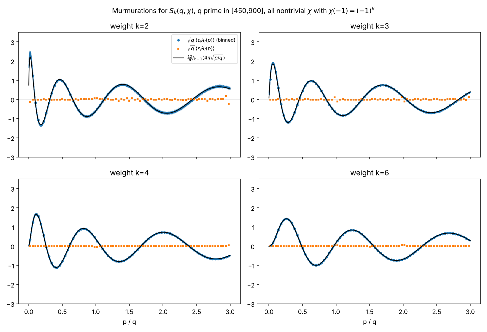

# Murmurations of modular forms with nebentypus

This repository contains the paper **"Murmurations of modular forms with nebentypus"** (Ramanuja) and the code that produces every table and figure in it.

📄 **Paper:** [`paper/nebentypus_murmurations.pdf`](paper/nebentypus_murmurations.pdf)

## What the paper is about

Murmurations are correlations between root numbers of modular forms and their Hecke eigenvalues at primes of the size of the conductor. Every holomorphic family studied so far is self-dual, so the root numbers are $\pm1$. This paper treats the simplest family that is *not* self-dual: newforms of weight $k \ge 2$ and odd squarefree level $N$ whose nebentypus $\chi$ is a primitive character modulo $N$. For these forms the root number $\varepsilon_f$ is a complex number of modulus one.

### Main results

Averaging over all such characters $\chi$ and forms $f$, the root number correlates with the eigenvalues $\overline{\lambda_f(p)}$ of the **dual** form, and the correlation is a **single Bessel function**:

| Weights | Average of $\varepsilon_f\,\overline{\lambda_f(p)}$ | Theorem |
|---|---|---|
| harmonic | $\dfrac{2\pi}{\sqrt N}\,J_{k-1}\bigl(4\pi\sqrt{p/N}\bigr)$ | 1 (prime $N$), 11 (squarefree $N$) |
| natural | $\dfrac{2\pi}{\zeta^{(N)}(2)\sqrt N}\Bigl(1+\dfrac1p\Bigr)J_{k-1}\bigl(4\pi\sqrt{p/N}\bigr)$ | 3 (prime $N$), 12 (squarefree $N$) |

Here $\zeta^{(N)}(2) = \zeta(2)\prod_{\ell\mid N}(1-\ell^{-2})$. All results are unconditional, come with explicit error terms, and hold **at each individual level**, with no average over $N$.

Without the complex conjugation, the correlation disappears. The average of $\varepsilon_f\lambda_f(p)$ is negligible unless $p$ lies in a few special residue classes modulo $N$ (Theorem 2).

### Methods

- **Harmonic weights:** the Petersson formula. The whole main term comes from the first Kloosterman modulus $c = N$, where the Gauss sums cancel exactly for every character. Averaging over $\chi$ makes all other moduli small.
- **Natural weights:** an exact formula in terms of Hurwitz class numbers, obtained from the Eichler–Selberg trace formula. The twist $e(t/N)$ is expanded in Chebyshev polynomials, and every mode is identified as a trace of a Hecke operator, which Deligne's bound makes small. Only the Eisenstein contribution survives. At prime level this is the Kronecker–Hurwitz relation; at squarefree level it is the weight-2 trace for the principal character.



*Figure 1 of the paper. Blue: the rescaled natural average of $\varepsilon_f\overline{\lambda_f(p)}$ over primes $q\in[450,900]$. Black: the predicted Bessel curve. Orange: the unconjugated statistic, which shows no murmuration.*

## Repository layout

```
paper/
  nebentypus_murmurations.tex    LaTeX source
  nebentypus_murmurations.pdf    compiled paper
  nebentypus_murmurations.png    Figure 1
code/
  hurwitz_sieve.py               Hurwitz class numbers H(m) for m <= 10^7
  trace_prime.py                 Eichler–Selberg trace formula on S_k(q, chi), q prime
  trace_squarefree.py            trace formula on S_k(N, chi), N odd squarefree, any chi mod N
  family_prime.py                closed-form family sums at prime level (Proposition 7)
  family_squarefree.py           family sums and constant fits at squarefree level (Table 3)
  make_figure.py                 Figure 1
  make_table_q797.py             Table 1
  error_prime.py                 Table 2 (error term in Theorem 3)
  error_squarefree.py            error test for Theorem 12
  check_*.py                     independent numerical checks (see below)
```

### Numerical checks

The analytic results depend on several sign and normalization conventions that differ across the literature. Each was verified numerically against eigenforms computed independently:

| Script | What it verifies |
|---|---|
| `check_trace_prime.py`, `check_trace_squarefree.py` | trace formula implementations (Hecke multiplicativity, dimensions, a known eta-product) |
| `check_root_number.py`, `check_root_number_squarefree.py` | the root number formula $\varepsilon_f = i^{-k}\tau(\chi)N^{-1/2}\,\overline{\lambda_f(N)}$ |
| `check_petersson.py` | the placement of $\chi$ and the conjugation in the Petersson formula |
| `check_family_sum.py`, `check_family_sum_conj.py` | the closed-form family sums (Proposition 7) |
| `check_proof_prime.py`, `check_proof_squarefree.py` | the individual steps of the proofs of Theorems 3 and 12 |
| `check_unconjugated_spikes.py` | the special residue classes in Theorem 2 |

## Reproducing the results

Requirements: Python 3 with `numpy` and `matplotlib`. Compiling the paper also needs a LaTeX distribution with `amsart`.

```bash
cd code
python hurwitz_sieve.py 1e7        # writes H_10000000.npy (~25 s, 40 MB; not tracked in git)
python make_figure.py              # Figure 1
python make_table_q797.py          # Table 1
python error_prime.py              # Table 2
python family_squarefree.py 4 471 687 865 851 899   # Table 3 (k = 4 column)
python check_petersson.py          # any of the check_*.py scripts
```

The full figure and the error tables take a few minutes each on a laptop.

```bash
cd paper
pdflatex nebentypus_murmurations.tex && pdflatex nebentypus_murmurations.tex
```

## Status

This is a preprint and has not yet been refereed. Comments and corrections are welcome. Please open an issue.

## Citation

```bibtex
@misc{ramanuja-nebentypus-murmurations,
  author = {Ramanuja},
  title  = {Murmurations of modular forms with nebentypus},
  year   = {2026},
  note   = {Preprint},
  url    = {https://github.com/ramanujamath/nebentypus-murmurations}
}
```
